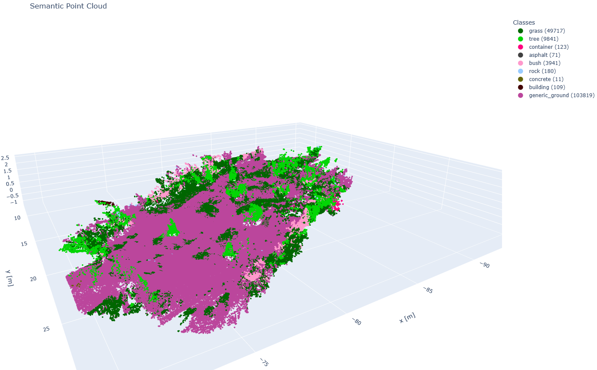
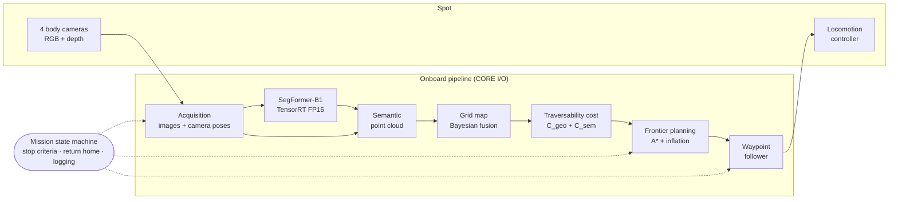
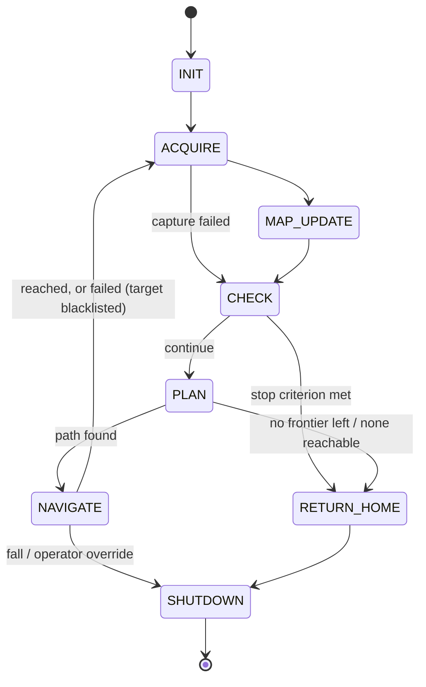
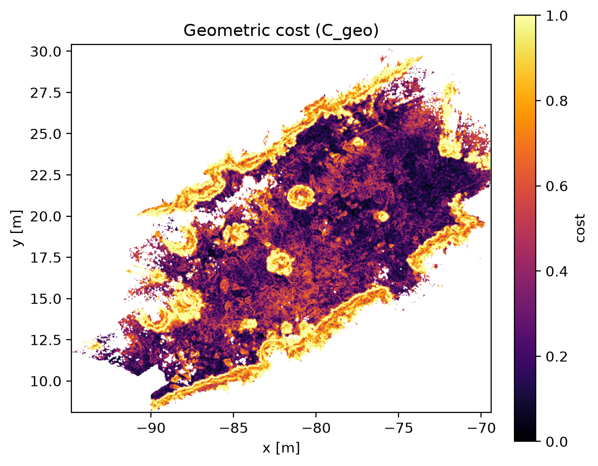
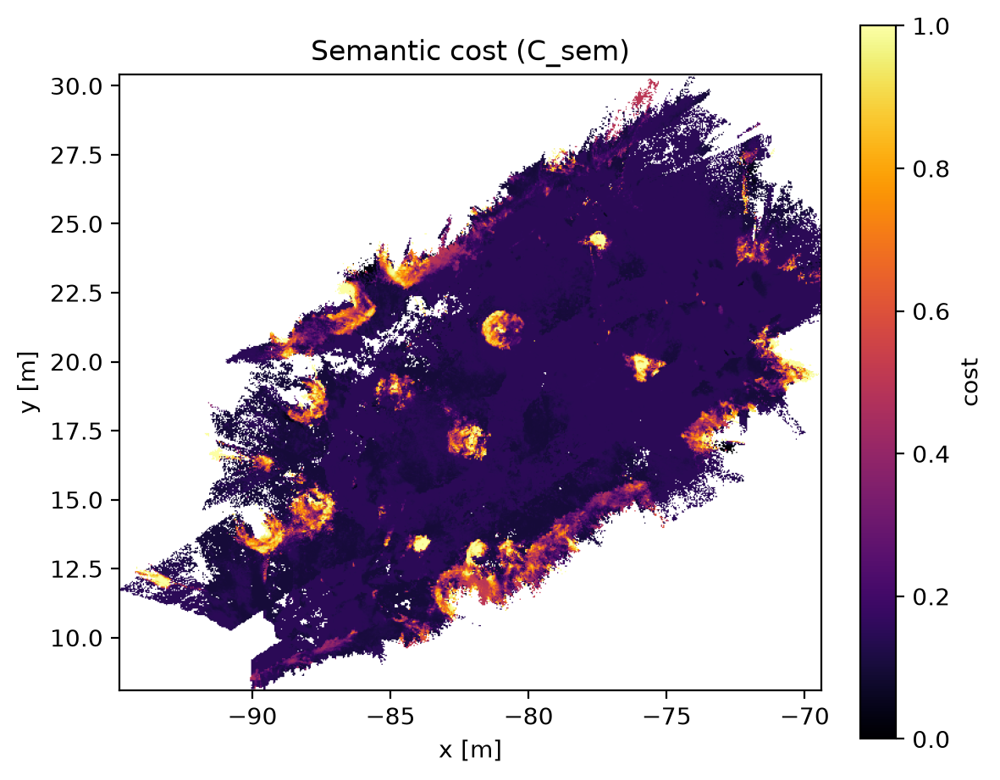
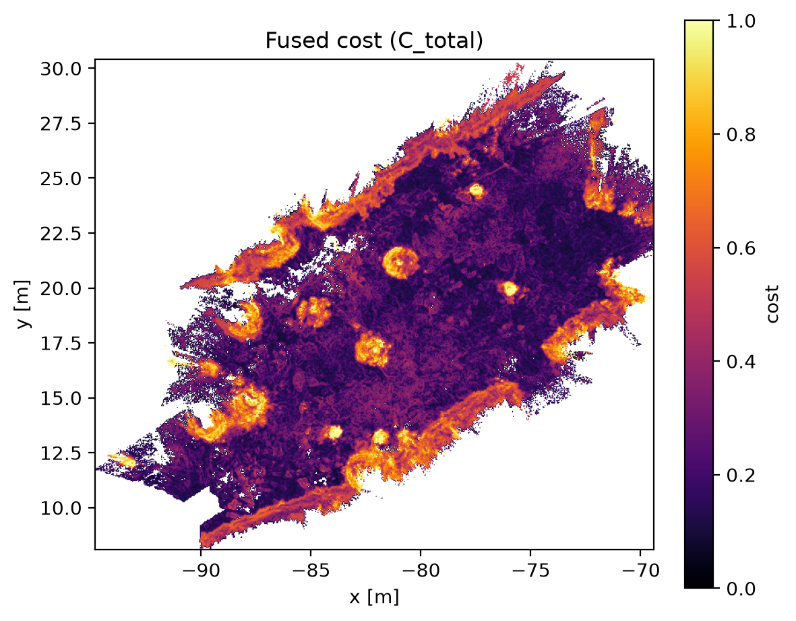

# Forest Semantic Navigation

**Autonomous semantic mapping and frontier-based exploration for the Boston Dynamics Spot robot in forest environments.**

Spot explores an unknown forest area on its own. At every stop it captures RGB and depth images from four body cameras, segments them with a SegFormer network running on the robot (TensorRT), and fuses the result into a probabilistic 2.5D elevation and semantic grid map. From that map it computes a geometric and semantic traversability cost, selects the most informative reachable frontier and plans a safe path to it with A\*. It then walks there, captures more images on the way, and repeats until a stop criterion is met, when it returns to its starting point.

Everything runs onboard, on Spot's CORE I/O payload (NVIDIA Jetson Xavier NX).

> Master's thesis project, M.Sc. in Artificial Intelligence, University of Florence. Target environment: the Vallombrosa forest (Tuscany, Italy).
> The segmentation model is trained in the companion repository [`Forest_Semantic_Segmentation`](https://github.com/digesaremarco/Forest_Semantic_Segmentation).

<p align="center">
  
  <br><em>Semantic elevation map built by Spot during an autonomous exploration (one point per grid cell, colored by its most likely class).</em>
</p>

---

## Overview

| | |
|---|---|
| **Robot** | Boston Dynamics Spot, Spot SDK (`bosdyn-client`) 5.2.0 |
| **Onboard compute** | Spot CORE I/O: NVIDIA Jetson Xavier NX, JetPack 5.1.2 (CUDA 11.4, TensorRT 8.5.2), Python 3.8 |
| **Sensors** | 4 body stereo cameras (`frontleft`, `frontright`, `left`, `right`): RGB 640×480 + depth registered to the RGB frame |
| **Perception** | SegFormer-B1 fine-tuned on ForestSim (24 classes, 16 retained for traversability), TensorRT FP16 |
| **Map** | Static 2.5D grid, 4 cm cells: elevation, variance, roughness, color, 16-class probabilities |
| **Cost** | Geometric (slope, roughness, step) + semantic (expected per-class cost), fused per cell |
| **Planning** | Frontier detection → mean-shift refinement → utility selection → A\* with robot-footprint inflation → smoothing |
| **Execution** | Stop-and-go mission state machine with captures on the move, stop criteria, return home, full timing and logging |

Main features:

- **Fully onboard and offline.** No GPS, no prior map, no network connection needed during the mission.
- **Probabilistic fusion.** Inverse-variance (Bayesian) fusion of heights and Dirichlet fusion of class probabilities, weighted by a calibrated stereo depth-noise model.
- **Safe planning.** Obstacles are inflated by the robot radius, Spot's own obstacle avoidance stays active as a safety layer, and failed targets are blacklisted.
- **Robust execution.** Detection of timeouts, stalls, blocked goals, operator override and falls. Clean shutdown on any error or Ctrl+C.
- **Measured and reproducible.** Every mission saves its raw images, poses, map, walked path, per-cycle timing and a summary, and can be replayed offline.

---

## System architecture



One **exploration cycle**, from one stop to the next:

1. **Acquire.** Capture all cameras at once, together with the pose of each camera.
2. **Map.** Segment, back-project and fuse the images taken here and those taken on the way since the last stop.
3. **Check.** Evaluate the stop criteria: coverage, time, battery, consecutive failures.
4. **Plan.** Choose the next frontier and plan a path to it.
5. **Navigate.** Walk the path without stopping at intermediate waypoints, capturing images every ~1 m, and stop at the frontier.

Each functional area lives in its own package, behind a small interface. Every package follows the same pattern: a YAML file in `config/`, a loader class, a processing class and a test script.

| Package | Role |
|---|---|
| `spot/` | SDK wrapper: connection, lease, power, stance, robot state |
| `acquisition/` | Synchronized image capture, decoding, per-camera poses, calibration check, logging to disk |
| `perception/` | SegFormer inference (ONNX Runtime or TensorRT), class reduction |
| `fusion/` | Camera calibration, semantic point cloud construction |
| `mapping/` | Static grid map with probabilistic fusion, visualization |
| `costmap/` | Geometric, semantic and fused traversability cost |
| `planning/` | Frontier detection, refinement, selection, A\*, inflation, smoothing, waypoints |
| `pipeline/` | `TraversabilityPipeline` and `PlanningPipeline`, the two sub-pipelines the mission composes |
| `navigation/` | Waypoint following with Spot's trajectory controller |
| `mission/` | State machine, stop criteria, timing, reports, plots |

---

## Method

### Image acquisition

At every capture a **single** `get_image` request retrieves 8 sources: for each of the four cameras, `<camera>_fisheye_image` (RGB, JPEG quality 90) and `<camera>_depth_in_visual_frame` (16-bit depth, pixel-aligned with the RGB image). A single request keeps the four cameras synchronized with one another.

**Camera pose.** The pose of each camera is read from the `transforms_snapshot` attached to that camera's depth image:

```math
{}^{V}T_{C} \;=\; {}^{V}T_{B}(t_d)\;{}^{B}T_{C}
```

Here $V$ is the `vision` frame, $B$ the body, $C$ the camera, and $t_d$ the acquisition time of the depth image. Because it is evaluated by the robot at the depth's own timestamp, the pose is synchronized with the geometry by construction. This holds even when the image is taken while walking, where RGB and depth can be tens of milliseconds apart.

**Checks on every capture.**
- The camera frame matches the calibration.
- The depth is registered to the RGB frame.
- The image size equals the calibrated raster.
- The RGB/depth time gap is at most 0.2 s.

**Decoding.** The JPEG is decoded and converted BGR→RGB explicitly. A missed conversion would feed SegFormer swapped channels without raising any error. A dedicated test checks the decoded array against a PIL decoding of the same bytes.

**Calibration check.** At startup, the image size, pinhole intrinsics and body→camera extrinsics reported live by the robot are compared with `camera_intrinsics.yaml`, with tolerances of 1 px, 1 cm and 1°. On the test robot the measured differences were 0.000 px, 0.0 mm and at most 0.012°.

**Captures on the move.** While walking, a capture is taken each time Spot passes an intermediate waypoint at least 1 m from the previous capture. Only `get_image` and decoding run on the move, about 0.2–0.3 s, in a single attempt. The snapshots are buffered and fused at the next stop, so the A\* path is never modified (see [3.8](#38-mission-state-machine)).

### Semantic segmentation

**Model.** SegFormer-B1 [1], fine-tuned on the ForestSim synthetic forest dataset (24 classes) with a **Tversky loss** [2]. The Tversky checkpoint was chosen for its qualitatively better detection of rocks and small obstacles. Of the 24 classes, the 16 relevant to traversability are kept for mapping:

`grass, tree, pole, water, vehicle, container, asphalt, gravel, mulch, rockbed, log, bush, rock, concrete, building, generic_ground`

**Preprocessing.** Resize to 512×512, scale to [0, 1], ImageNet normalization, CHW layout.

Spot's front cameras are mounted rolled by about 90° and the right camera by 180°. Images are kept in the camera's **native raster**, which is the raster the calibration refers to. They are rotated by $k_c$ quarter turns **only for the network**, and the probability maps are rotated back before being associated with the depth.

**Backends.** Selected in `perception_config.yaml`:

| Backend | Where | Notes |
|---|---|---|
| `onnx` | development PC | ONNX Runtime, CUDA with automatic CPU fallback |
| `tensorrt` | Spot CORE I/O | Serialized FP16 engine built **on the device** with `trtexec`. GPU buffers through torch, pycuda or cuda-python. No silent CPU fallback |

On the Jetson Xavier NX, TensorRT inference takes **≈ 95 ms per image** (preprocessing + inference + copy of the 24×512×512 probabilities). The whole point-cloud construction takes 0.2–0.35 s per camera.

### Semantic point cloud

For every pixel $(u, v)$ with a valid depth, the raw 16-bit value is converted to meters. Spot reports `depth_scale` as a **divisor**:

```math
d = \frac{D_{\text{raw}}(u,v)}{s_d}, \qquad 0 < d < d_{\max} = 4\ \text{m}
```

The pixel is then back-projected with the pinhole model into the camera **optical frame** (x right, y down, z forward):

```math
\mathbf{p}_C = \begin{bmatrix} (u - c_x)\, d / f_x \\ (v - c_y)\, d / f_y \\ d \end{bmatrix},
\qquad
\mathbf{p}_W = R\,\mathbf{p}_C + \mathbf{t}
```

Here $(R, \mathbf{t})$ is the camera pose from [3.1](#31-image-acquisition). Each point carries its 16-class probability vector $\mathbf{p}_k$, taken from the segmentation at the same pixel.

### Probabilistic elevation and semantic mapping

**The grid.** The map is a **static, world-axis-aligned grid** (no rolling buffer). In the current configuration it is $L = 40$ m wide with $r = 4$ cm cells, i.e. 1000×1000 cells. It is anchored once, at the first update, so its center cell sits at the first camera position. The robot moves through the grid; the grid never moves.

**Layers.** Each cell stores:
- elevation $\hat h$ and its posterior variance;
- roughness;
- color;
- the 16 class probabilities;
- the number of observations and the accumulated weight.

Cells never observed are `NaN` in every layer: 0 is a valid observed value and cannot mean "unknown".

The fusion follows the closed-form, "no-forgetting" cases of MEM [3]. These are the right choice for a single static field session, with no dynamic scene and no continuous drift to forget.

#### Depth noise model

Stereo depth error comes from the disparity error, so it depends on the depth $d$ along the optical axis, not on the Euclidean distance:

```math
\sigma^2(d) = \sigma_0^2 + \alpha\, d^{\,p}
```

**Calibration.** The model was fitted on the per-pixel temporal variance of a standing robot.
- The log-log slope of $\sigma$ against $d$ is 2.01, against 2.0 predicted by stereo theory, which gives $p = 4$.
- The fit gives $\alpha = 1.7\times10^{-5}$.
- The predicted standard deviation is 0.4 cm at 1 m, 1.7 cm at 2 m, 3.7 cm at 3 m and 6.6 cm at 4 m.
- $\sigma_0 = 3$ mm is a deliberate conservative floor, not the fitted value (≈ 0). It covers errors the temporal method cannot observe (calibration, pose, systematic bias) and prevents very close points from getting a near-infinite weight.

Each point gets a weight normalized to a reference depth $d_{\text{ref}} = 1$ m:

```math
w_i = \frac{\sigma^2(d_{\text{ref}})}{\sigma^2(d_i)}
```

With this normalization, accumulated weights read as "equivalent number of observations at 1 m".

#### Elevation: Bayesian fusion of Gaussian measurements

Each point $i$ falling in a cell is an independent Gaussian measurement of the cell height, $h_i \sim \mathcal{N}(h, \sigma^2(d_i))$. With a flat prior, the posterior is Gaussian, with the inverse-variance weighted mean and variance:

```math
\hat h = \frac{\sum_i w_i\, h_i}{\sum_i w_i},
\qquad
\sigma_{\hat h}^2 = \Big(\sum_i \frac{1}{\sigma^2(d_i)}\Big)^{-1} = \frac{\sigma^2(d_{\text{ref}})}{\sum_i w_i}
```

**Implementation.** Both quantities are kept as running sums ($\sum w_i$, $\sum w_i h_i$) and divided lazily when read, to avoid incremental floating-point drift. The color layer is fused the same way.

**Optimistic variance.** The posterior variance is optimistic: points of the same frame share correlated errors (stereo bias, pose error). It is used as a *relative* confidence only.

**Roughness.** The actual height spread inside a cell, due to grass, stones or debris, is measured separately by the roughness layer, the weighted empirical variance:

```math
\rho^2 = \frac{\sum_i w_i\,(h_i - \hat h)^2}{\sum_i w_i}
```

#### Semantics: Dirichlet fusion of class probabilities

The class distribution of a cell is modeled with a Dirichlet distribution with a flat prior. The update is additive: each point adds its probability vector, scaled by its weight, so far and noisy points contribute less evidence. The posterior mean is the normalized distribution:

```math
\alpha_k = \sum_i w_i\, p_{i,k},
\qquad
\hat p_k = \frac{\alpha_k}{\sum_j \alpha_j} = \frac{\sum_i w_i\, p_{i,k}}{\sum_i w_i}
```

The last equality holds because every $\mathbf{p}_i$ sums to 1.

#### Vertical datum

The `odom` and `vision` frames put $z = 0$ roughly at body height at boot, not on the ground. On the first frame with enough ground points, the ground plane is fitted with RANSAC:
- on points between 0.5 m and 3 m from the camera;
- with a 3 cm inlier threshold and 300 iterations;
- rejecting planes steeper than 30°;
- requiring at least 500 inliers.

The plane is evaluated below the camera and stored as the **height datum** $h_0$. The elevation layer returns $\hat h - h_0$, so the ground under the start pose is 0.

The datum is fixed once per session and applied only when the layer is read. It can be replaced later without re-fusing. Roughness and slope are height differences and do not depend on it.

#### Keyframes

A camera is fused only if it moved at least 0.10 m **or** turned at least 5° since its last fused frame:

```math
\lVert \mathbf{t} - \mathbf{t}_{\text{last}} \rVert \ge 0.10\ \text{m}
\quad\lor\quad
\angle\!\left(R_{\text{last}}^{\top} R\right) \ge 5^\circ
```

Re-fusing a static view would add the same correlated stereo errors again and inflate the cells' confidence.

### Traversability cost

All cost layers are in $[0, 1]$, where 0 is fully traversable and 1 is an obstacle. A cell is `NaN` wherever it has no information: "unknown" is never treated as safe or as unsafe.

#### Geometric cost

Three factors are derived from the elevation layer and saturated at a threshold:

```math
c_{\text{slope}} = \min\!\Big(\frac{\theta}{\theta_{\max}},\,1\Big),\quad
c_{\text{rough}} = \min\!\Big(\frac{\sigma_h}{\sigma_{\max}},\,1\Big),\quad
c_{\text{step}}  = \min\!\Big(\frac{s}{s_{\max}},\,1\Big)
```

- $\theta = \arctan\lVert\nabla \hat h\rVert$ is the local slope angle, with $\theta_{\max} = 30^\circ$ (Spot's nominal maximum slope).
- $\sigma_h$ is the standard deviation of the elevation in a 5×5-cell window (20×20 cm), with $\sigma_{\max} = 0.15$ m.
- $s = \max_{n \in \mathcal{N}_4} |\hat h - \hat h_n|$ is the largest step to a 4-connected neighbor, with $s_{\max} = 0.20$ m.

```math
C_{\text{geo}} = w_{\text{slope}}\,c_{\text{slope}} + w_{\text{rough}}\,c_{\text{rough}} + w_{\text{step}}\,c_{\text{step}},
\qquad (w_{\text{slope}}, w_{\text{rough}}, w_{\text{step}}) = (0.4,\,0.3,\,0.3)
```

#### Semantic cost

The semantic cost is the expected per-class cost under the cell's class distribution:

```math
C_{\text{sem}} = \sum_{k=1}^{16} \hat p_k\, c_{\text{class}}(k)
```

The per-class costs are set in `class_costs.yaml`:

| Class | $c_{\text{class}}$ | Class | $c_{\text{class}}$ |
|---|---|---|---|
| asphalt, concrete | 0.05 | log, rock | 0.60 |
| grass | 0.10 | pole, water | 0.90 |
| gravel, mulch, generic_ground | 0.15 | tree, vehicle, container, building | 1.00 |
| rockbed | 0.35 | bush | 0.50 |

#### Fusion

The two costs are combined with a weighted average:

```math
C_{\text{total}} =
\begin{cases}
w_{\text{geo}}\,C_{\text{geo}} + w_{\text{sem}}\,C_{\text{sem}} & \text{both available}\\
C_{\text{geo}} & \text{only } C_{\text{geo}}\\
C_{\text{sem}} & \text{only } C_{\text{sem}}
\end{cases}
\qquad w_{\text{geo}} = w_{\text{sem}} = 0.5
```

When only one cost is available, the formula falls back to it. This is equivalent to renormalizing the weights over the factors actually present.

### Frontier-based exploration planning

Planning works on the grid, on $C_{\text{total}}$. Its output is a list of waypoints in the `vision` frame.

**Cell classification.** With $\tau_{\text{occ}} = 0.7$:

```math
\text{unknown} = \{C = \text{NaN}\},\qquad
\text{occupied} = \{C \ge \tau_{\text{occ}}\},\qquad
\text{free} = \{C < \tau_{\text{occ}}\}
```

**Frontiers** [4]:
- A frontier cell is an *unknown* cell with at least one 4-connected *free* neighbor.
- Frontier cells are grouped into clusters with 8-connectivity; clusters smaller than 5 cells are discarded.
- Cells within 10 cells of the grid border are ignored: the border is a limit of the data structure, not of the world.

**Target point.** A cluster's mean centroid can be a poor target: for a ring of frontier around the robot it coincides with the robot itself. Each cluster is therefore retargeted to its cell **closest to the robot among those at least $d_{\min} = 0.75$ m away**. The cameras never see the ground right around Spot, so that blind ring would otherwise always be the "nearest frontier".

**Mean-shift refinement** [5]. The target is moved toward nearby cheap free cells. Each free cell $f$ within the bandwidth $b = 5$ cells pulls it with weight

```math
\omega(f) = \exp\!\Big(-\tfrac12\big(\lVert f - x\rVert / b\big)^2\Big)\,\big(1 - C(f)\big)
```

$x$ is moved to the weighted mean of its neighborhood until convergence, at most 10 iterations. The total displacement is capped at 8 cells, so the target keeps pointing at its frontier.

**Selection.** Each candidate $f$ is scored by a utility that balances information gain against navigation cost:

```math
U(f) = \beta_g\,\frac{G(f)}{\max_{f'} G(f')} \;-\; \beta_c\,\frac{K(f)}{\max_{f'} K(f')},
\qquad \beta_g = \beta_c = 1
```

- $G(f)$ is the number of unknown cells within 15 cells of $f$, a proxy for information gain.
- $K(f) = \lVert f - x_r\rVert\,\big(1 + \bar C_{\text{line}}\big)$ is a cheap navigation-cost estimate, where $\bar C_{\text{line}}$ is the mean cost sampled on the straight line from the robot $x_r$ to $f$ (NaN counted as 1).

Candidates are tried in decreasing utility, up to 3, until A\* finds a path. If A\* fails on all of them, the tried targets are blacklisted and planning is repeated, up to 5 times per cycle.

**Robot-footprint inflation.** A\* would otherwise treat Spot as a point. Let $\delta(c)$ be the Euclidean distance of cell $c$ to the nearest occupied cell (distance transform). With $r_{\text{robot}} = 0.35$ m, $r_s = 0.5$ m and $c_{\max} = 0.6$:

```math
\text{blocked}(c) \iff \delta(c) \le r_{\text{robot}},
\qquad
c_{\text{infl}}(c) = c_{\max}\Big(1 - \frac{\delta(c) - r_{\text{robot}}}{r_s}\Big)\ \ \text{for } r_{\text{robot}} < \delta(c) < r_{\text{robot}} + r_s
```

The search cost is $C_{\text{plan}} = \max(C_{\text{total}}, c_{\text{infl}})$ on known cells.

- The hard zone keeps Spot's body clear of obstacles: the narrowest passage planned through is $2 r_{\text{robot}} = 0.7$ m.
- The soft zone keeps paths in the middle of passages.
- Occupied cells under the robot (cost artifacts) are removed before inflating, and a disc of radius $r_{\text{robot}}$ around the start is cleared.
- Targets inside the hard zone are snapped to the nearest traversable cell within 0.5 m, or discarded.

**A\*** [6]. A\* runs on an 8-connected grid, excluding blocked cells. The edge cost from cell $a$ to neighbor $b$ is

```math
g(a \to b) = w_d\,\lVert a - b\rVert\,r \;+\; w_t\,C_{\text{plan}}(b),
\qquad w_d = w_t = 0.5,\quad C_{\text{plan}}(\text{NaN}) = 1
```

The heuristic $h(a) = w_d\,\lVert a - g\rVert\,r$ ignores the non-negative traversability term, so it is admissible and the search is optimal.

Unknown cells are crossable with the maximum penalty. Treating them as impassable would make most frontiers, which lie at the edge of unknown space, unreachable.

**Smoothing.** Greedy line-of-sight shortcutting. A shortcut is accepted only if it crosses no blocked cell **and** its mean cost is at most $(1 + 0.1)$ times the mean cost of the A\* segment it replaces. This way it never cuts through "free but costly" terrain that A\* deliberately avoided.

**Waypoints.** The smoothed polyline is resampled by arc length every $\Delta s = 0.5$ m. Waypoint $i$ gets the heading of the next segment:

```math
\psi_i = \operatorname{atan2}(y_{i+1} - y_i,\; x_{i+1} - x_i)
```

As a result, Spot walks facing forward and stops at the frontier facing the unexplored area.

**Return home.** The same chain (inflation, A\*, smoothing, waypoints) is used to plan to an arbitrary goal, the start pose, on the current map.

### Waypoint following

Each waypoint is sent to Spot's own trajectory controller as a `synchro_se2_trajectory_point_command` $(x, y, \psi)$ in the `vision` frame. Velocity limits are 0.5 m/s forward, 0.3 m/s lateral and 0.6 rad/s. Spot's vision-based obstacle avoidance stays active with 0.1 m padding.

**Control loop at 10 Hz** (`feedback_period_s = 0.1`). At every iteration the follower reads:
- the body pose;
- the active behavior faults;
- the command feedback, i.e. mobility status, trajectory status and final-goal status.

**No stops at intermediate waypoints.** As soon as the body is within 0.3 m of an intermediate waypoint, the next one is commanded. The new command replaces the running one, so Spot keeps walking. Only the final waypoint is driven to a full stop: it is reached when Spot reports the trajectory `STOPPED` with the body within 0.2 m.

**Start.** Following starts from the waypoint closest to the robot and skips those within the pass-through radius, so the robot never walks back.

**Failure detection.** Any failure ends the navigation and stops the robot:

| Outcome | Condition |
|---|---|
| `timeout` | waypoint budget $T = T_0 + d/v_{\text{nom}}$ exceeded ($T_0 = 10$ s, $v_{\text{nom}} = 0.25$ m/s), or path longer than 300 s |
| `stalled` | distance to the waypoint did not decrease by 0.1 m within 8 s |
| `blocked` | Spot reports `FINAL_GOAL_STATUS_BLOCKED` for 3 s, or the final trajectory stops short of the goal |
| `command_failed` | command overridden (operator took control from the tablet), timed out on the robot, robot frozen |
| `fault` | an active behavior fault, e.g. a fall |

Each command is valid on the robot for $T + 5$ s, so the robot-side expiry never fires before the follower's own timeout.

### Mission state machine



**States.**

| State | What happens |
|---|---|
| `INIT` | E-stop check, lease taken from the tablet, power on, stand, acquisition setup and calibration check. The current pose becomes **home** |
| `ACQUIRE` | One capture of all cameras at the stop, after 0.5 s of settling |
| `MAP_UPDATE` | Fusion of the snapshots buffered on the way, then of the stop snapshot (keyframes only); coverage recomputed |
| `CHECK` | Stop criteria (below) |
| `PLAN` | Next frontier ([3.6](#36-frontier-based-exploration-planning)) |
| `NAVIGATE` | Waypoint following ([3.7](#37-waypoint-following)) with captures on the move. On `timeout`, `stalled` or `blocked` the target is blacklisted and the robot acquires where it stopped |
| `RETURN_HOME` | Plan to home on the current map and follow it. Up to 3 attempts, each re-acquiring and replanning from where the previous one stopped |
| `SHUTDOWN` | Sit, power off, lease returned |

**Coverage.** Coverage is the observed fraction of the **explorable region** $\mathcal{R}$: the grid minus the border band ignored by frontier detection, which the robot is never sent to observe.

```math
\text{coverage} = \frac{\big|\{c \in \mathcal{R} : n_{\text{obs}}(c) > 0\}\big|}{|\mathcal{R}|}
```

**Stop criteria.** The first one met ends the exploration, and the robot then returns home:
- coverage ≥ 85%;
- exploration time ≥ 30 min;
- battery < 30%;
- 3 consecutive navigation failures;
- 3 consecutive acquisition failures;
- no frontier left, or none reachable.

**Aborts.** A fall or an operator override aborts without returning home. Ctrl+C, or any exception, stops the robot, sits it down, powers it off and saves everything.

**Timing.** The experiment is timed on the monotonic clock:
- intervals: init, exploration, return home, shutdown, total;
- per phase: total, count, mean, min, max of acquisition, mapping, planning, navigation, captures on the move and cycle.

Loading the models happens before the clock starts, as setup.

`PLAN_ONLY` mode runs one acquisition–mapping–planning cycle without taking the lease. It is the safe first test in a new place.

---

## Reference frames and conventions

| Item | Convention |
|---|---|
| World frame (missions) | Spot `vision` frame: visual-inertial odometry, less drift than kinematic `odom` |
| World frame (offline datasets) | `odom` (poses from the logged CSV + static extrinsics) |
| Camera frame | Optical: x right, y down, z forward. `frame_name_image_sensor` (e.g. `frontleft_fisheye`) |
| Poses | `(R, t)` NumPy pairs, $R \in \mathbb{R}^{3\times3}$, $\mathbf{t} \in \mathbb{R}^3$, float64, mapping child → parent |
| Images | Native camera raster everywhere; rotated upright only inside the SegFormer call |
| Grid indices | `(row, col)`, $x = (\text{col} - N/2)\,r + x_0$, $y = (\text{row} - N/2)\,r + y_0$ |
| Unknown | `NaN` in every map and cost layer |

---

## Results

An autonomous exploration in a wooded area, covering about 25 × 22 m. The three cost layers below are computed on the map shown at the top of this page.

<table>
  <tr>
    <td align="center" width="33%"><br><em>Geometric cost C<sub>geo</sub></em></td>
    <td align="center" width="33%"><br><em>Semantic cost C<sub>sem</sub></em></td>
    <td align="center" width="33%"><br><em>Fused cost C<sub>total</sub></em></td>
  </tr>
</table>

- **Tree trunks** appear in both components. In $C_{\text{geo}}$ they show up as ring-shaped peaks, from the height step around the trunk base. In $C_{\text{sem}}$ they show up as compact high-cost blobs (class `tree`).
- **The margins of the explored area**, made of vegetation and uneven ground, are expensive mainly geometrically.
- **The open ground**, mostly classified as `generic_ground` and `grass`, stays cheap in both components.
- **The fused cost** keeps the obstacles both components agree on and smooths the isolated geometric noise of the open ground.


---

## Repository structure

```
Forest_Semantic_Navigation/
├── main.py                       # mission entry point (runs on the CORE I/O)
├── config/                       # one YAML per module (see Section 8)
├── spot/                         # SDK wrapper
│   ├── spot_interface.py         #   connection, lease, power, stance, state, shutdown
│   ├── spot_config_loader.py
│   └── frame_utils.py            #   SE3 ↔ (R, t), yaw, quaternions
├── acquisition/
│   ├── image_acquirer.py         #   synchronized capture, decoding, poses, calibration check
│   ├── observation_logger.py     #   raw snapshots to disk (replayable offline)
│   ├── acquisition_snapshot.py   #   data contracts
│   └── acquisition_config_loader.py
├── perception/
│   ├── segformer_inference.py    #   ONNX Runtime / TensorRT backends
│   ├── tensorrt_runner.py        #   engine loading, GPU buffers (torch / pycuda / cuda-python)
│   ├── class_reducer.py          #   24 → 16 classes
│   └── perception_config_loader.py
├── fusion/
│   ├── pointcloud_builder.py     #   semantic point cloud
│   ├── camera_calibration_loader.py
│   └── frame_pose_pairing.py     #   offline image ↔ pose pairing
├── mapping/
│   ├── grid_map.py               #   static grid, Bayesian / Dirichlet fusion, height datum
│   ├── grid_map_visualizer.py
│   └── grid_map_config_loader.py
├── costmap/
│   ├── geometric_cost.py         #   slope, roughness, step
│   ├── semantic_cost.py          #   expected per-class cost
│   ├── cost_fusion.py
│   └── costmap_config_loader.py
├── planning/
│   ├── frontier_detector.py  frontier_refiner.py  frontier_selector.py
│   ├── path_planner.py           #   A*
│   ├── obstacle_inflation.py     #   robot-footprint inflation
│   ├── path_smoother.py  waypoint_generator.py
│   ├── target_blacklist.py  replanning_trigger.py
│   ├── planning_visualizer.py
│   └── planning_config_loader.py
├── pipeline/
│   ├── traversability_pipeline.py
│   └── planning_pipeline.py
├── navigation/
│   ├── waypoint_follower.py      #   10 Hz trajectory following, failure detection
│   ├── nav_result.py
│   └── navigation_config_loader.py
├── mission/
│   ├── exploration_mission.py    #   state machine
│   ├── stop_criteria.py          #   stop criteria + coverage
│   ├── mission_timer.py          #   experiment timing
│   ├── mission_report.py         #   logs, CSVs, summary
│   ├── mission_plotter.py        #   mission_path.png
│   └── mission_config_loader.py
├── test/                         # offline (simulated) and on-robot tests, analysis tools
└── images/
```

---

## Limitations and future work

**Perception.**
- **Synthetic-to-real gap.** The model is trained on synthetic data (ForestSim). Real grass is often labeled `generic_ground`, which has a similar cost. Fine-tuning on annotated Vallombrosa images would close the gap.

**Mapping.**
- **2.5D map.** One height per cell: canopies, overhangs and the space under branches are not represented. Trees are seen mostly at the trunk base.
- **Short depth range.** Depth is cut at 4 m, where stereo noise is already about 6.6 cm, so distant areas fill in only as the robot approaches.
- **Rear coverage.** The `back` camera is not used: each stop leaves the rear uncovered until the robot turns.
- **Odometry drift.** No loop closure: drift of the `vision` frame accumulates over long missions.

**Exploration.**
- **Stop-and-go is slow.** It trades speed for simple, sharp, well-posed acquisitions; captures on the move already reduce the gaps between stops. A continuous pipeline with fusion in the background would be the next step.
- **Replanning.** Replanning on cost changes along the current path is not implemented; there is a placeholder in `ReplanningTrigger`.

**Evaluation.**
- **Traversability.** The predicted traversability needs systematic field validation against ground truth: where Spot actually walked, slipped or got blocked.

---

## References

1. E. Xie, W. Wang, Z. Yu, A. Anandkumar, J. M. Alvarez, P. Luo. *SegFormer: Simple and Efficient Design for Semantic Segmentation with Transformers.* NeurIPS 2021.
2. S. S. M. Salehi, D. Erdogmus, A. Gholipour. *Tversky loss function for image segmentation using 3D fully convolutional deep networks.* MLMI 2017.
3. G. Erni, J. Frey, T. Miki, M. Mattamala, M. Hutter. *MEM: Multi-Modal Elevation Mapping for Robotics and Learning.* IROS 2023.
4. B. Yamauchi. *A frontier-based approach for autonomous exploration.* CIRA 1997.
5. D. Comaniciu, P. Meer. *Mean shift: a robust approach toward feature space analysis.* IEEE TPAMI, 2002.
6. P. E. Hart, N. J. Nilsson, B. Raphael. *A Formal Basis for the Heuristic Determination of Minimum Cost Paths.* IEEE Transactions on Systems Science and Cybernetics, 1968.
7. T. Miki, L. Wellhausen, R. Grandia, F. Jenelten, T. Homberger, M. Hutter. *Elevation Mapping for Locomotion and Navigation using GPU.* IROS 2022.
8. S. Thrun, W. Burgard, D. Fox. *Probabilistic Robotics.* MIT Press, 2005.
